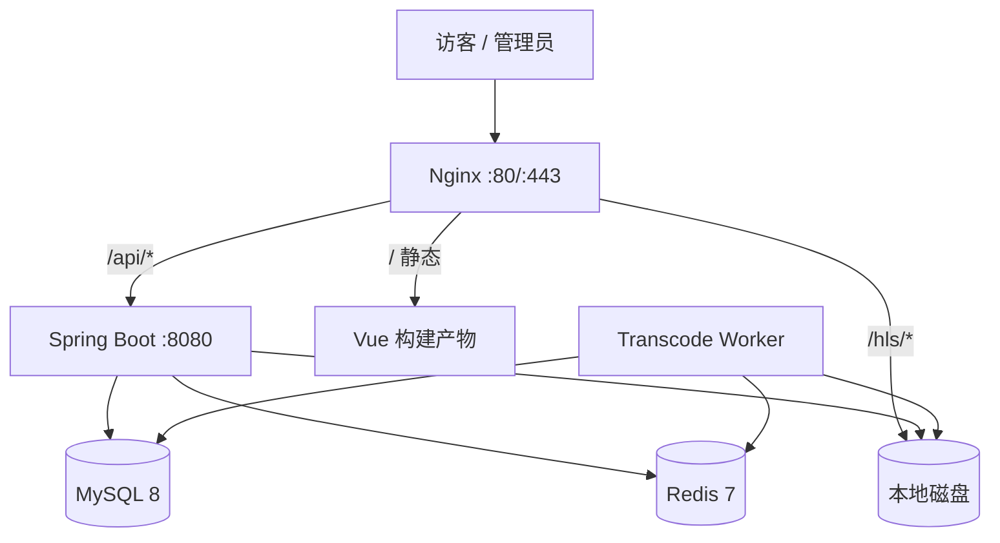
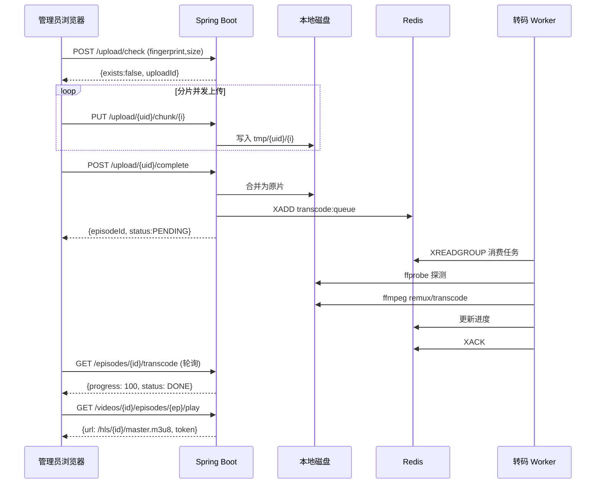
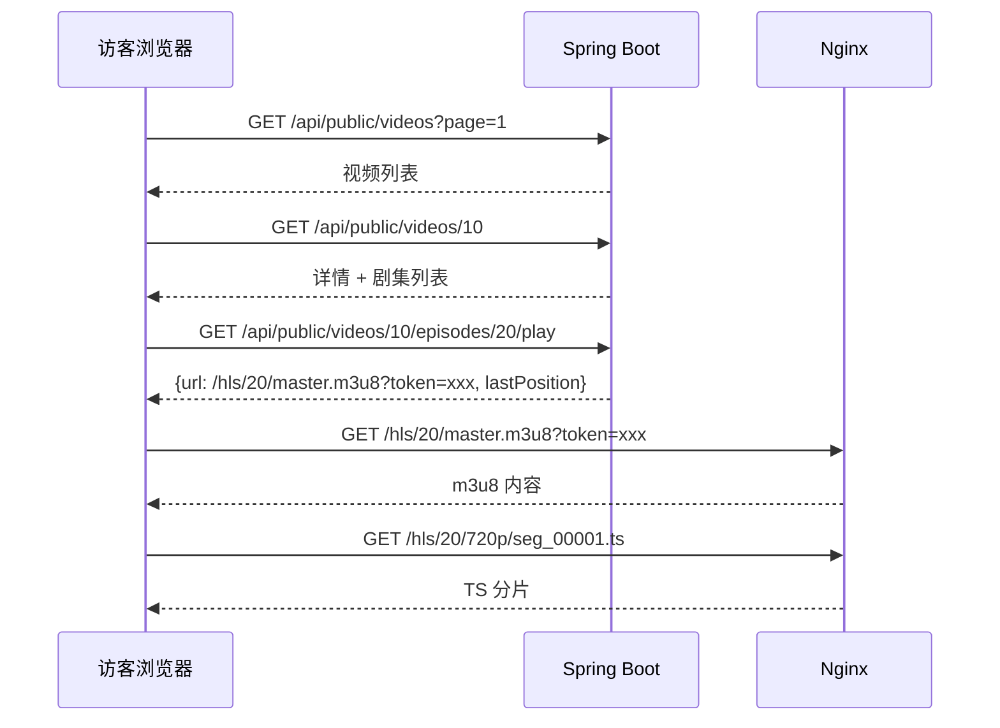
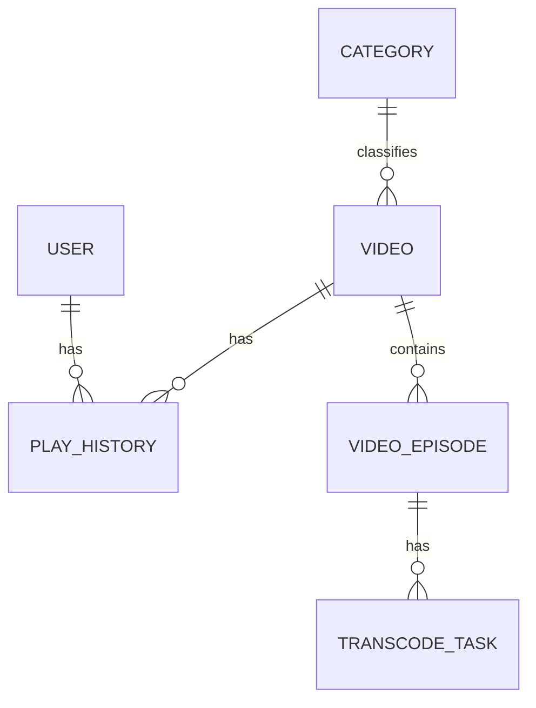
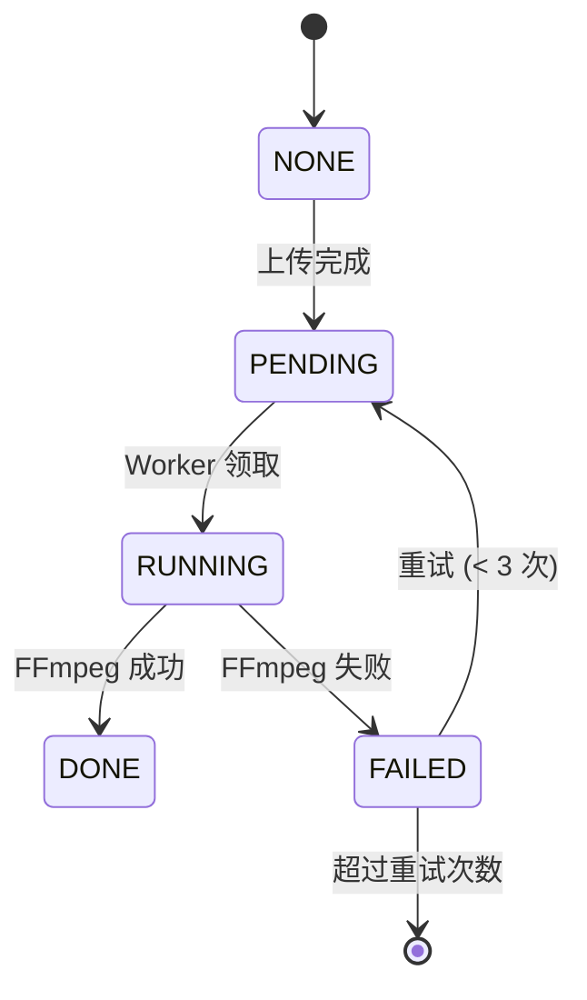

# 自建视频站 · 技术选型与功能开发文档

| 项 | 内容 |
|---|---|
| 文档版本 | v1.1 |
| 编写日期 | 2026-11-16 |
| 状态 | 待评审 |
| 目标读者 | 开发负责人、AI 编码助手 |
| 文档用途 | 作为本项目**唯一开发依据**，所有代码实现以本文档为准 |

> **v1.1 变更**：移除聚合源/采集/代理全部功能，聚焦自有视频上传与播放；新增"测试免费方案 + 生产推荐"部署章节；工期由 18 天调整为 13 天。

---

## 目录

1. [项目概述](#1-项目概述)
2. [需求清单](#2-需求清单)
3. [技术选型](#3-技术选型)
4. [系统架构](#4-系统架构)
5. [数据模型](#5-数据模型)
6. [接口设计](#6-接口设计)
7. [核心功能详细设计](#7-核心功能详细设计)
8. [部署方案](#8-部署方案)
9. [开发计划](#9-开发计划)
10. [测试与验收](#10-测试与验收)
11. [风险与对策](#11-风险与对策)
12. [AI 辅助开发指引](#12-ai-辅助开发指引)
13. [附录](#13-附录)

---

## 1. 项目概述

### 1.1 背景

需要一个**纯自有内容**的自建视频站：管理员在后台上传视频，系统自动转码为 HLS，前台访客可以直接观看。不接入任何第三方影视采集源。

### 1.2 目标

- 单台服务器部署，运维成本最低
- 管理后台完整支持上传、转码、视频管理
- 前台支持浏览、播放、进度记忆
- 国内外均可访问
- 代码结构清晰，便于后续 AI 辅助迭代
- **测试阶段零成本起步**，验证后再买正式服务器

### 1.3 规模假设（关键约束，所有设计以此为准）

| 维度 | 当前值 | 1 年后预期 | 设计余量 |
|---|---|---|---|
| 视频数量 | 1 个 | ≤ 30 个 | 按 100 个设计 |
| 单视频大小 | 3 GB / 3 小时 | 同量级 | 按 10 GB 设计 |
| 存储总量 | 6 GB（含 HLS） | ≤ 200 GB | 预留 500 GB |
| 同时在线 | 几十人 | 几十人 | 按 50 并发设计 |
| 峰值带宽 | 45 Mbps（30人×720P） | 75 Mbps | 按 100 Mbps 设计 |
| 月流量 | ≤ 1.2 TB | ≤ 2 TB | 按 5 TB 设计 |

> **设计原则：不提前过度设计。** 存储、带宽、并发都按"当前值的 3–5 倍"留余量，避免为不存在的规模买单。

### 1.4 核心用户故事

| 编号 | 角色 | 故事 |
|---|---|---|
| US-01 | 管理员 | 我可以上传 3GB 大文件视频，支持断点续传，上传后自动转码 |
| US-02 | 管理员 | 我可以查看转码进度，失败后可以重试 |
| US-03 | 管理员 | 我可以编辑视频标题、封面、分类、上下架 |
| US-04 | 管理员 | 我可以把多个视频归到一个作品下（多集/多 P） |
| US-05 | 访客 | 我可以浏览视频列表，点击播放，拖动进度条 |
| US-06 | 访客 | 我关掉页面再回来，可以从中断处继续播放 |
| US-07 | 访客 | 我在手机上也能正常观看 |

### 1.5 非目标（本期明确不做）

- ❌ **聚合源 / 第三方采集 / m3u8 代理**（v1.0 设计已废弃，如未来需要另立方案）
- ❌ 用户注册 / 评论 / 弹幕 / 点赞（访客免登录观看）
- ❌ 付费会员、支付、订单
- ❌ 多租户、多机构
- ❌ 分布式部署、集群、多机
- ❌ 移动端 App（只做响应式 Web）
- ❌ 实时直播推流

---

## 2. 需求清单

### 2.1 功能需求（MoSCoW 优先级）

#### P0 — 必须有（MVP 边界）

| 编号 | 模块 | 功能 | 验收标准 |
|---|---|---|---|
| F-01 | 认证 | 管理员登录 | 账号密码登录，JWT 有效期 7 天 |
| F-02 | 上传 | 分片上传 | 3GB 文件可上传，单分片 5MB，支持断点续传 |
| F-03 | 上传 | 秒传 | 相同文件指纹直接复用，不重复上传 |
| F-04 | 转码 | 自动探测 + 转 HLS | 上传完成后自动转码，输出可播放的 m3u8 |
| F-05 | 转码 | 进度展示 | 后台可见转码百分比与状态 |
| F-06 | 播放 | HLS 播放 | 网页可播放，支持拖动、倍速、全屏 |
| F-07 | 播放 | 进度记忆 | 刷新/重进后从上次位置继续 |
| F-08 | 管理 | 视频 CRUD | 新增/编辑/删除/上下架 |
| F-09 | 管理 | 剧集管理 | 一个作品可挂多个视频文件（多 P） |
| F-10 | 管理 | 封面管理 | 可自动截帧或手动上传 |
| F-11 | 前台 | 视频列表 + 详情页 | 分页展示，点击进入播放页 |
| F-12 | 前台 | 响应式 | 手机/平板/桌面均可正常观看 |

#### P1 — 应该有（上线后第一批迭代）

| 编号 | 功能 | 说明 |
|---|---|---|
| F-13 | 分类管理 | 电影/剧集/课程等分类，前台可按分类筛选 |
| F-14 | 视频搜索 | 标题搜索 |
| F-15 | 播放统计 | 播放次数、观看时长 |
| F-16 | 多码率 | 720P + 480P 双档，前端自动切换 |
| F-17 | 防盗链 | 播放地址签名，防止被外站盗用 |
| F-18 | 站点访问口令 | 全站需要输入密码才能访问（内网场景） |
| F-19 | 操作日志 | 管理员操作审计 |

#### P2 — 可以有（远期）

| 编号 | 功能 |
|---|---|
| F-20 | 弹幕 |
| F-21 | 评论 |
| F-22 | 收藏 / 观看历史列表 |
| F-23 | 对象存储（S3/OSS）适配 |

### 2.2 非功能需求

| 类别 | 指标 | 说明 |
|---|---|---|
| **性能** | 首帧 < 2 秒 | 720P 视频，正常网络 |
| | 拖动 seek < 1 秒 | HLS 分片 6 秒，允许丢帧定位 |
| | 列表接口 P95 < 300ms | |
| | 上传吞吐 ≥ 2 MB/s | 受服务器带宽限制 |
| **并发** | 50 人同时 720P 播放 | 约 75 Mbps |
| **可用性** | 单机，允许重启维护 | 不追求 99.9% |
| **安全** | 密码 BCrypt；接口 JWT；上传类型白名单；路径穿越防护 | |
| **可维护** | 单命令启动；日志按天切割；配置外置 | |
| **合规** | 上传内容必须拥有合法权利 | 见第 11 章风险 |

---

## 3. 技术选型

### 3.1 选型原则

1. **AI 友好优先**：选 AI 训练语料最多的框架（Spring Boot / Vue3），生成准确率最高
2. **单机优先**：不引入 K8s、消息中间件、微服务
3. **只选一个组件解决一个问题**：不堆技术栈
4. **可替换**：存储、队列等关键依赖做接口抽象，便于后续升级
5. **版本锁定**：使用 LTS 版本，不用最新 beta

### 3.2 技术栈总览

| 层 | 技术 | 版本 | 选型理由 |
|---|---|---|---|
| 语言 | Java | 21 (LTS) | 长期支持，AI 语料最多 |
| 框架 | Spring Boot | 3.3.x | 生态最全，Spring Security 直接可用 |
| ORM | MyBatis-Plus | 3.5.7 | 国内主流，CRUD 代码量最少 |
| 数据库 | MySQL | 8.0 | 元数据量小，够用 |
| 缓存 | Redis | 7.x | 会话、上传会话、转码进度 |
| 鉴权 | Spring Security + JWT | jjwt 0.12.x | 标准方案 |
| 转码 | FFmpeg | 6.1+ | 事实标准 |
| Web 服务器 | Nginx | 1.25+ | 静态 HLS 分发 |
| 前端框架 | Vue | 3.4+ | 组合式 API，语料多 |
| 前端语言 | TypeScript | 5.4+ | 类型安全，AI 生成更准 |
| 构建 | Vite | 5.x | 启动快 |
| UI 组件 | Element Plus | 2.8+ | 后台管理系统首选 |
| 状态管理 | Pinia | 2.x | Vue3 官方推荐 |
| 播放器 | ArtPlayer | 5.x | 国产，文档中文，扩展好 |
| HLS 内核 | hls.js | 1.5.x | 浏览器 HLS 事实标准 |
| HTTP | Axios | 1.7+ | 标准 |
| 部署 | Docker + Docker Compose | 24+ | 一条命令起全套 |

### 3.3 后端选型说明

#### Spring Boot 3.3 + JDK 21
- JDK 21 是 LTS，虚拟线程对 IO 密集场景有优势
- Spring Boot 3.x 基于 Jakarta EE 9+，包名 `jakarta.*`
- **不选** Spring Cloud：单机不需要

#### MyBatis-Plus 而非 JPA
- 国内团队熟悉，SQL 可控
- 代码生成器可减少 70% 样板代码

#### 存储：本地文件系统（不使用 MinIO）
| 方案 | 结论 |
|---|---|
| 本地文件系统 | ✅ **采用**。单机、数据量小、运维零成本 |
| MinIO | ❌ 不采用。多一个进程、多一份内存，收益为零 |
| 云对象存储 | ⏸ 预留 `StorageService` 接口，后续可切换 |

#### 队列：Redis Stream（不使用 RabbitMQ）
- 转码任务是低频、单消费者场景
- Redis 已经在用，不再引入中间件
- 用 `XADD / XREADGROUP / XACK` 实现消费确认

#### 不引入的组件及理由

| 组件 | 不引入理由 |
|---|---|
| RabbitMQ / Kafka | 流量极小，Redis Stream 足够 |
| Elasticsearch | 视频数 ≤ 100，MySQL `LIKE` 完全够 |
| MinIO | 单机无必要 |
| Spring Cloud / Nacos | 单体应用，无服务发现需求 |
| Quartz | 用 Spring `@Scheduled` 即可 |
| WebSocket | 转码进度用轮询（2 秒一次）即可，实现更简单 |

### 3.4 前端选型说明

#### Vue 3 + TypeScript + Vite
- Vue3 组合式 API 更适合 AI 生成
- TS 提供类型约束，减少 AI 幻觉
- Vite 热更新快，开发体验好

#### 双端结构（一个 Vite 项目）

| 端 | 路由前缀 | UI 方案 | 用户 |
|---|---|---|---|
| 管理后台 | `/admin/*` | Element Plus | 管理员 |
| 用户前台 | `/*` | 自研轻量样式 + Element Plus 局部组件 | 访客 |

> 不拆两个项目，避免重复构建与部署。

#### 播放器：ArtPlayer + hls.js
- ArtPlayer 中文文档完善，插件生态好
- hls.js 负责 HLS 解码
- **不选** Video.js：配置繁琐，中文生态弱
- **不选** DPlayer：维护活跃度下降

### 3.5 版本锁定清单

#### 后端 `pom.xml` 关键依赖

```xml
<properties>
    <java.version>21</java.version>
    <spring-boot.version>3.3.5</spring-boot.version>
    <mybatis-plus.version>3.5.7</mybatis-plus.version>
    <jjwt.version>0.12.6</jjwt.version>
    <hutool.version>5.8.32</hutool.version>
</properties>
```

#### 前端 `package.json` 关键依赖

```json
{
  "dependencies": {
    "vue": "^3.4.38",
    "vue-router": "^4.4.3",
    "pinia": "^2.2.2",
    "element-plus": "^2.8.1",
    "axios": "^1.7.4",
    "artplayer": "^5.2.3",
    "hls.js": "^1.5.15",
    "dayjs": "^1.11.13"
  },
  "devDependencies": {
    "vite": "^5.4.2",
    "typescript": "^5.5.4",
    "vue-tsc": "^2.1.4",
    "sass": "^1.77.8"
  }
}
```

---

## 4. 系统架构

### 4.1 部署架构（单机 Docker Compose）



### 4.2 分层架构

```
Controller  →  入参校验、权限、响应封装
    ↓
Service     →  业务编排、事务边界
    ↓
Mapper      →  单表 CRUD（MyBatis-Plus）
    ↓
Infra       →  存储、FFmpeg、Redis
```

### 4.3 后端目录结构

```
video-server/
├── pom.xml
└── src/main/
    ├── java/com/video/
    │   ├── VideoApplication.java
    │   ├── common/
    │   │   ├── Result.java              统一响应
    │   │   ├── PageResult.java          分页响应
    │   │   ├── ErrorCode.java           错误码枚举
    │   │   ├── BizException.java        业务异常
    │   │   └── GlobalExceptionHandler.java
    │   ├── config/
    │   │   ├── MybatisPlusConfig.java
    │   │   ├── RedisConfig.java
    │   │   ├── WebMvcConfig.java        CORS、拦截器
    │   │   ├── SecurityConfig.java
    │   │   └── AsyncConfig.java         转码线程池
    │   ├── security/
    │   │   ├── JwtUtil.java
    │   │   ├── JwtAuthFilter.java
    │   │   └── LoginUser.java
    │   ├── infra/
    │   │   ├── storage/
    │   │   │   ├── StorageService.java
    │   │   │   └── LocalStorageService.java
    │   │   ├── ffmpeg/
    │   │   │   ├── FfprobeService.java
    │   │   │   ├── FfmpegService.java
    │   │   │   └── TranscodeProfile.java
    │   │   └── queue/
    │   │       └── RedisStreamQueue.java
    │   └── module/
    │       ├── auth/      认证
    │       ├── user/      用户
    │       ├── video/     视频/剧集
    │       ├── upload/    分片上传
    │       ├── transcode/ 转码任务
    │       ├── play/      播放、进度
    │       └── category/  分类
    ├── resources/
    │   ├── application.yml
    │   ├── application-prod.yml
    │   └── mapper/*.xml
    └── test/
```

### 4.4 前端目录结构

```
video-web/
├── package.json
├── vite.config.ts
├── index.html
└── src/
    ├── main.ts
    ├── App.vue
    ├── api/
    │   ├── request.ts          Axios 封装（拦截器、错误处理）
    │   ├── auth.ts
    │   ├── video.ts
    │   ├── upload.ts
    │   ├── transcode.ts
    │   └── play.ts
    ├── router/
    │   └── index.ts            路由表 + 守卫
    ├── stores/
    │   ├── user.ts
    │   └── player.ts           播放进度
    ├── layouts/
    │   ├── AdminLayout.vue
    │   └── PortalLayout.vue
    ├── views/
    │   ├── admin/
    │   │   ├── Login.vue
    │   │   ├── Dashboard.vue
    │   │   ├── VideoList.vue
    │   │   ├── VideoEdit.vue
    │   │   ├── VideoUpload.vue
    │   │   └── CategoryList.vue
    │   └── portal/
    │       ├── Home.vue
    │       ├── VideoDetail.vue
    │       └── Player.vue
    ├── components/
    │   ├── VideoCard.vue
    │   ├── HlsPlayer.vue       播放器封装
    │   └── UploadPanel.vue     分片上传组件
    └── utils/
        ├── hash.ts             文件抽样哈希
        └── format.ts
```

### 4.5 两条核心链路

#### 链路 1：上传 → 转码 → 播放



#### 链路 2：访客访问 → 播放



---

## 5. 数据模型

### 5.1 实体关系



### 5.2 表清单

| 表名 | 说明 | 预估行数 |
|---|---|---|
| `user` | 管理员账号 | < 10 |
| `category` | 分类 | < 20 |
| `video` | 视频作品（元信息） | ≤ 1000 |
| `video_episode` | 播放单元（单文件作品 = 1 条；多集作品 = N 条） | ≤ 10000 |
| `transcode_task` | 转码任务 | ≤ 1000 |
| `play_history` | 播放进度 | ≤ 10000 |

### 5.3 建表 SQL

```sql
SET NAMES utf8mb4;
SET FOREIGN_KEY_CHECKS = 0;

-- ----------------------------
-- 1. 用户表
-- ----------------------------
CREATE TABLE `user` (
  `id`          BIGINT UNSIGNED NOT NULL AUTO_INCREMENT,
  `username`    VARCHAR(64)     NOT NULL COMMENT '登录名',
  `password`    VARCHAR(128)    NOT NULL COMMENT 'BCrypt 哈希',
  `nickname`    VARCHAR(64)     DEFAULT NULL,
  `avatar`      VARCHAR(512)    DEFAULT NULL,
  `role`        VARCHAR(16)     NOT NULL DEFAULT 'USER' COMMENT 'ADMIN / USER',
  `status`      TINYINT         NOT NULL DEFAULT 1 COMMENT '1正常 0禁用',
  `created_at`  DATETIME        NOT NULL DEFAULT CURRENT_TIMESTAMP,
  `updated_at`  DATETIME        NOT NULL DEFAULT CURRENT_TIMESTAMP ON UPDATE CURRENT_TIMESTAMP,
  PRIMARY KEY (`id`),
  UNIQUE KEY `uk_username` (`username`)
) ENGINE=InnoDB DEFAULT CHARSET=utf8mb4 COMMENT='用户';

-- ----------------------------
-- 2. 分类表
-- ----------------------------
CREATE TABLE `category` (
  `id`          BIGINT UNSIGNED NOT NULL AUTO_INCREMENT,
  `name`        VARCHAR(64)     NOT NULL,
  `sort`        INT             NOT NULL DEFAULT 0,
  `created_at`  DATETIME        NOT NULL DEFAULT CURRENT_TIMESTAMP,
  PRIMARY KEY (`id`),
  UNIQUE KEY `uk_name` (`name`)
) ENGINE=InnoDB DEFAULT CHARSET=utf8mb4 COMMENT='分类';

-- ----------------------------
-- 3. 视频作品表
-- ----------------------------
CREATE TABLE `video` (
  `id`            BIGINT UNSIGNED NOT NULL AUTO_INCREMENT,
  `title`         VARCHAR(255)    NOT NULL,
  `description`   TEXT,
  `cover_url`     VARCHAR(512)    DEFAULT NULL,
  `category_id`   BIGINT UNSIGNED DEFAULT NULL,
  `view_count`    BIGINT          NOT NULL DEFAULT 0,
  `status`        TINYINT         NOT NULL DEFAULT 1 COMMENT '1上线 0下线',
  `created_at`    DATETIME        NOT NULL DEFAULT CURRENT_TIMESTAMP,
  `updated_at`    DATETIME        NOT NULL DEFAULT CURRENT_TIMESTAMP ON UPDATE CURRENT_TIMESTAMP,
  PRIMARY KEY (`id`),
  KEY `idx_status_created` (`status`, `created_at`),
  KEY `idx_category` (`category_id`),
  KEY `idx_title` (`title`(64))
) ENGINE=InnoDB DEFAULT CHARSET=utf8mb4 COMMENT='视频作品';

-- ----------------------------
-- 4. 播放单元（剧集）表
-- ----------------------------
CREATE TABLE `video_episode` (
  `id`               BIGINT UNSIGNED NOT NULL AUTO_INCREMENT,
  `video_id`         BIGINT UNSIGNED NOT NULL,
  `episode_no`       INT             NOT NULL DEFAULT 1 COMMENT '第几集，单文件作品固定为1',
  `title`            VARCHAR(255)    DEFAULT NULL,
  `play_type`        VARCHAR(16)     NOT NULL DEFAULT 'HLS_LOCAL'
                     COMMENT '预留：HLS_LOCAL 本地转码',
  `duration`         INT             DEFAULT NULL COMMENT '秒',
  -- 上传文件信息
  `storage_key`      VARCHAR(512)    DEFAULT NULL COMMENT '原片相对路径',
  `file_size`        BIGINT          DEFAULT NULL COMMENT '字节',
  `file_fingerprint` CHAR(64)        DEFAULT NULL COMMENT '抽样指纹，秒传用',
  `file_md5`         CHAR(32)        DEFAULT NULL COMMENT '完整 MD5，合并后校验',
  `width`            INT             DEFAULT NULL,
  `height`           INT             DEFAULT NULL,
  `bit_rate`         INT             DEFAULT NULL COMMENT 'bps',
  -- 转码状态
  `transcode_status` VARCHAR(16)     NOT NULL DEFAULT 'NONE'
                     COMMENT 'NONE/PENDING/PROCESSING/DONE/FAILED',
  `transcode_mode`   VARCHAR(16)     DEFAULT NULL COMMENT 'REMUX/TRANSCODE',
  `hls_master_url`   VARCHAR(512)    DEFAULT NULL COMMENT 'master.m3u8 相对路径',
  `created_at`       DATETIME        NOT NULL DEFAULT CURRENT_TIMESTAMP,
  `updated_at`       DATETIME        NOT NULL DEFAULT CURRENT_TIMESTAMP ON UPDATE CURRENT_TIMESTAMP,
  PRIMARY KEY (`id`),
  UNIQUE KEY `uk_video_ep` (`video_id`, `episode_no`),
  KEY `idx_status` (`transcode_status`),
  KEY `idx_fingerprint` (`file_fingerprint`)
) ENGINE=InnoDB DEFAULT CHARSET=utf8mb4 COMMENT='播放单元';

-- ----------------------------
-- 5. 转码任务表
-- ----------------------------
CREATE TABLE `transcode_task` (
  `id`          BIGINT UNSIGNED NOT NULL AUTO_INCREMENT,
  `episode_id`  BIGINT UNSIGNED NOT NULL,
  `status`      VARCHAR(16)     NOT NULL DEFAULT 'PENDING'
                COMMENT 'PENDING/RUNNING/SUCCESS/FAILED',
  `mode`        VARCHAR(16)     DEFAULT NULL COMMENT 'REMUX/TRANSCODE',
  `progress`    TINYINT         NOT NULL DEFAULT 0 COMMENT '0-100',
  `retry_count` TINYINT         NOT NULL DEFAULT 0,
  `error_msg`   VARCHAR(1024)   DEFAULT NULL,
  `started_at`  DATETIME        DEFAULT NULL,
  `finished_at` DATETIME        DEFAULT NULL,
  `created_at`  DATETIME        NOT NULL DEFAULT CURRENT_TIMESTAMP,
  PRIMARY KEY (`id`),
  KEY `idx_episode` (`episode_id`),
  KEY `idx_status` (`status`)
) ENGINE=InnoDB DEFAULT CHARSET=utf8mb4 COMMENT='转码任务';

-- ----------------------------
-- 6. 播放进度表
-- ----------------------------
CREATE TABLE `play_history` (
  `id`          BIGINT UNSIGNED NOT NULL AUTO_INCREMENT,
  `device_id`   VARCHAR(64)     NOT NULL COMMENT '匿名设备标识（存 localStorage）',
  `video_id`    BIGINT UNSIGNED NOT NULL,
  `episode_id`  BIGINT UNSIGNED NOT NULL,
  `position`    INT             NOT NULL DEFAULT 0 COMMENT '秒',
  `duration`    INT             DEFAULT NULL,
  `updated_at`  DATETIME        NOT NULL DEFAULT CURRENT_TIMESTAMP ON UPDATE CURRENT_TIMESTAMP,
  PRIMARY KEY (`id`),
  UNIQUE KEY `uk_device_ep` (`device_id`, `episode_id`),
  KEY `idx_video` (`video_id`)
) ENGINE=InnoDB DEFAULT CHARSET=utf8mb4 COMMENT='播放进度';

SET FOREIGN_KEY_CHECKS = 1;
```

### 5.4 关键设计说明

| 设计点 | 说明 |
|---|---|
| `video` + `video_episode` 拆分 | 单文件视频 = 1 个 video + 1 个 episode；多集作品 = 1 个 video + N 个 episode。**播放接口统一**，前端不感知差异 |
| `file_fingerprint` | 前端抽样哈希，用于秒传；`file_md5` 是服务端合并后的完整校验 |
| `transcode_status` 放在 episode 上 | 一个作品多集时，每集独立转码 |
| `device_id` 而非 `user_id` | 访客免登录，用浏览器生成的 UUID 识别设备 |
| 无外键约束 | 便于后期分库，靠应用层保证一致性 |

---

## 6. 接口设计

### 6.1 通用规范

#### URL 规范
```
/api/{模块}/{资源}[/{id}][/{子资源}]
管理接口统一前缀：/api/admin/**
公开接口统一前缀：/api/public/**
```

#### 统一响应体
```json
{ "code": 0, "message": "ok", "data": {} }
```

- `code = 0` 表示成功，非 0 表示业务错误
- HTTP 状态码统一 200（业务错误走 code），404/500 只用于框架级错误

#### 分页响应
```json
{
  "code": 0,
  "data": { "total": 100, "page": 1, "size": 20, "records": [] }
}
```

#### 错误码表

| 码 | 含义 |
|---|---|
| 0 | 成功 |
| 1001 | 参数校验失败 |
| 1002 | 请求体过大 |
| 2001 | 未登录 / Token 失效 |
| 2002 | 账号或密码错误 |
| 2003 | 无权限 |
| 3001 | 资源不存在 |
| 3002 | 资源状态不允许该操作 |
| 4001 | 上传会话不存在 |
| 4002 | 分片序号越界 |
| 4003 | 文件合并失败 / MD5 不匹配 |
| 4004 | 磁盘空间不足 |
| 5001 | 转码任务创建失败 |
| 5002 | FFmpeg 执行失败 |
| 9001 | 系统内部错误 |

#### 鉴权

- 请求头：`Authorization: Bearer <jwt>`
- JWT payload：`{ "sub": userId, "role": "ADMIN", "exp": ... }`
- 有效期：7 天
- 除 `/api/public/**`、`/api/auth/login`、`/hls/**` 外，其余均需鉴权

### 6.2 接口清单

#### 认证模块

| 方法 | 路径 | 说明 | 权限 |
|---|---|---|---|
| POST | `/api/auth/login` | 登录 | 公开 |
| GET | `/api/auth/me` | 当前用户信息 | 登录 |
| POST | `/api/auth/logout` | 登出（前端清 token 即可） | 登录 |

#### 视频管理（后台）

| 方法 | 路径 | 说明 | 权限 |
|---|---|---|---|
| GET | `/api/admin/videos` | 分页列表（标题、状态、分类筛选） | ADMIN |
| GET | `/api/admin/videos/{id}` | 详情（含 episodes） | ADMIN |
| POST | `/api/admin/videos` | 新建作品（先建壳，再传视频） | ADMIN |
| PUT | `/api/admin/videos/{id}` | 编辑标题/简介/封面/分类 | ADMIN |
| DELETE | `/api/admin/videos/{id}` | 删除（级联 episode 与文件） | ADMIN |
| PUT | `/api/admin/videos/{id}/status` | 上下架 | ADMIN |
| DELETE | `/api/admin/episodes/{id}` | 删除单集 | ADMIN |

#### 上传模块

| 方法 | 路径 | 说明 |
|---|---|---|
| POST | `/api/admin/upload/check` | 秒传检查 + 续传会话查询 |
| POST | `/api/admin/upload/init` | 初始化上传会话 |
| PUT | `/api/admin/upload/{uploadId}/chunk/{index}` | 上传分片 |
| GET | `/api/admin/upload/{uploadId}/status` | 已上传分片列表 |
| POST | `/api/admin/upload/{uploadId}/complete` | 合并并创建 episode |

#### 转码模块

| 方法 | 路径 | 说明 |
|---|---|---|
| GET | `/api/admin/episodes/{episodeId}/transcode` | 查询转码状态与进度 |
| POST | `/api/admin/episodes/{episodeId}/transcode/retry` | 重试转码 |
| POST | `/api/admin/episodes/{episodeId}/transcode/cancel` | 取消转码 |

#### 播放模块（公开）

| 方法 | 路径 | 说明 |
|---|---|---|
| GET | `/api/public/videos` | 前台视频列表（分页、分类、搜索） |
| GET | `/api/public/videos/{id}` | 前台视频详情（含剧集列表） |
| GET | `/api/public/videos/{id}/episodes/{ep}/play` | 获取播放地址 + 签名 |
| POST | `/api/public/play/history` | 上报播放进度 |
| GET | `/api/public/play/history` | 查询进度（按 deviceId） |

#### 分类模块

| 方法 | 路径 | 说明 |
|---|---|---|
| GET | `/api/public/categories` | 分类列表 |
| POST | `/api/admin/categories` | 新增 |
| PUT | `/api/admin/categories/{id}` | 编辑 |
| DELETE | `/api/admin/categories/{id}` | 删除 |

### 6.3 关键接口详细定义

#### 6.3.1 登录

`POST /api/auth/login`

请求：
```json
{ "username": "admin", "password": "123456" }
```

响应：
```json
{
  "code": 0,
  "data": {
    "token": "eyJhbGciOiJIUzI1NiJ9...",
    "expiresIn": 604800,
    "user": { "id": 1, "username": "admin", "nickname": "管理员", "role": "ADMIN" }
  }
}
```

#### 6.3.2 秒传检查 / 续传会话查询

`POST /api/admin/upload/check`

请求：
```json
{ "fingerprint": "a1b2c3...64位", "fileName": "movie.mp4", "fileSize": 3221225472 }
```

响应（命中，直接复用）：
```json
{ "code": 0, "data": { "exists": true, "episodeId": 12 } }
```

响应（未命中，返回可续传会话）：
```json
{
  "code": 0,
  "data": {
    "exists": false,
    "uploadId": "a1b2c3d4",
    "chunkSize": 5242880,
    "totalChunks": 615,
    "uploadedChunks": [0, 1, 2]
  }
}
```

#### 6.3.3 初始化上传

`POST /api/admin/upload/init`

请求：
```json
{ "fileName": "movie.mp4", "fileSize": 3221225472, "fingerprint": "a1b2c3..." }
```

响应：
```json
{
  "code": 0,
  "data": { "uploadId": "a1b2c3d4", "chunkSize": 5242880, "totalChunks": 615 }
}
```

#### 6.3.4 上传分片

`PUT /api/admin/upload/{uploadId}/chunk/{index}`

- `Content-Type: application/octet-stream`
- Body 为原始二进制分片
- 分片大小固定 5MB（最后一片除外）

响应：
```json
{ "code": 0, "data": { "index": 0, "received": true } }
```

#### 6.3.5 完成上传

`POST /api/admin/upload/{uploadId}/complete`

请求：
```json
{ "videoId": 10, "episodeNo": 1, "title": "第一集", "coverMode": "AUTO" }
```

响应：
```json
{ "code": 0, "data": { "episodeId": 20, "transcodeStatus": "PENDING" } }
```

服务端行为：
1. 按 `index` 升序合并分片
2. 校验最终 MD5
3. 落盘到 `uploads/{yyyy}/{MM}/{uuid}.mp4`
4. 创建 `video_episode`
5. 创建 `transcode_task`
6. `XADD` 到 Redis Stream
7. 清理临时分片目录

#### 6.3.6 查询转码进度

`GET /api/admin/episodes/{episodeId}/transcode`

响应：
```json
{
  "code": 0,
  "data": {
    "episodeId": 20,
    "status": "RUNNING",
    "progress": 45,
    "mode": "TRANSCODE",
    "errorMsg": null
  }
}
```

#### 6.3.7 获取播放地址

`GET /api/public/videos/{id}/episodes/{ep}/play`

响应：
```json
{
  "code": 0,
  "data": {
    "type": "HLS",
    "url": "/hls/20/master.m3u8?expire=1732000000&token=xxx",
    "poster": "/covers/10.jpg",
    "duration": 10800,
    "lastPosition": 3600
  }
}
```

#### 6.3.8 上报播放进度

`POST /api/public/play/history`

请求：
```json
{ "deviceId": "web-8f3a2b", "videoId": 10, "episodeId": 20, "position": 3600, "duration": 10800 }
```

响应：
```json
{ "code": 0 }
```

---

## 7. 核心功能详细设计

### 7.1 分片上传

#### 7.1.1 流程

```
┌─────────┐   1.check(fingerprint,size)  ┌──────────┐
│ 浏览器  │ ───────────────────────────► │  后端    │
│         │ ◄─────────────────────────── │          │
└─────────┘   {exists / uploadId}        └──────────┘
     │
     │ 2. 若未命中：init → 得到 uploadId, chunkSize=5MB
     │
     │ 3. 查询 status 得已传分片 → 跳过
     │
     │ 4. 并发上传（默认 3 并发）
     │    PUT chunk/{index}
     │
     │ 5. complete → 合并、校验、建 episode、入队转码
     │
     ▼
   轮询转码进度
```

#### 7.1.2 前端文件指纹策略

3GB 文件全量 MD5 需要几十秒，因此采用**抽样哈希**：

```ts
// 取文件前 2MB + 中间 2MB + 末尾 2MB + 文件大小 组成指纹
async function sampleFingerprint(file: File): Promise<string> {
  const CHUNK = 2 * 1024 * 1024;
  const slices = [
    file.slice(0, CHUNK),
    file.slice(Math.floor(file.size / 2), Math.floor(file.size / 2) + CHUNK),
    file.slice(file.size - CHUNK)
  ];
  const buffers = await Promise.all(slices.map(s => s.arrayBuffer()));
  const total = buffers.reduce((n, b) => n + b.byteLength, 0) + 8;
  const combined = new Uint8Array(total);
  let offset = 0;
  for (const b of buffers) {
    combined.set(new Uint8Array(b), offset);
    offset += b.byteLength;
  }
  new DataView(combined.buffer, offset, 8).setFloat64(0, file.size);
  const hash = await crypto.subtle.digest('SHA-256', combined);
  return Array.from(new Uint8Array(hash)).map(b => b.toString(16).padStart(2, '0')).join('');
}
```

> 抽样指纹用于秒传判断；完整 MD5 在服务端合并后计算，作为最终校验。

#### 7.1.3 断点续传

- 分片落盘路径：`/data/tmp/{uploadId}/{index}.part`
- `GET status` 返回已存在分片序号列表
- 前端重传时跳过已上传分片
- 上传会话 Redis 记录：`upload:{uploadId}` → `{fileName, fileSize, totalChunks, chunkSize, fingerprint}`，TTL 24 小时

#### 7.1.4 合并

```java
// 按 index 升序，用 FileChannel.transferTo 零拷贝合并
try (FileChannel out = FileChannel.open(target, CREATE, WRITE)) {
    for (int i = 0; i < totalChunks; i++) {
        Path part = tmpDir.resolve(i + ".part");
        try (FileChannel in = FileChannel.open(part, READ)) {
            long pos = 0, size = in.size();
            while (pos < size) pos += in.transferTo(pos, size - pos, out);
        }
    }
}
```

#### 7.1.5 边界情况

| 场景 | 处理 |
|---|---|
| 分片重复上传 | 覆盖写，幂等 |
| 分片乱序 | 允许，合并时按 index 排序 |
| 中途关闭浏览器 | 分片保留，重新打开后 status 续传 |
| 合并后 MD5 不匹配 | 删除合并文件，返回 4003，提示重传 |
| 磁盘空间不足 | 合并前检查可用空间，不足返回 4004 |
| 上传会话过期 | 清理 tmp 目录，前端重新 init |
| 超大文件（>10GB） | 拒绝，返回参数错误（本期上限 10GB） |

**磁盘空间检查**：
```java
FileStore store = Files.getFileStore(dataPath);
long usable = store.getUsableSpace();
if (usable < fileSize * 1.2) throw new BizException(ErrorCode.DISK_FULL);
```

### 7.2 转码流水线

#### 7.2.1 状态机



#### 7.2.2 转码决策（核心）

```java
public TranscodeDecision decide(ProbeResult probe) {
    // 1. 判断编码
    boolean isH264 = "h264".equalsIgnoreCase(probe.codec());
    boolean isMp4  = probe.format().contains("mp4");
    boolean bitrateOk = probe.bitRate() <= 3_000_000; // ≤3Mbps

    // 2. H.264 + MP4 + 码率合理 → 只 remux，不重编码（最快、无损）
    if (isH264 && isMp4 && bitrateOk) {
        return new TranscodeDecision(Mode.REMUX, List.of(Profile.P720));
    }

    // 3. 需要重编码 → 根据源分辨率决定输出档位
    List<Profile> profiles = new ArrayList<>();
    if (probe.height() >= 720) profiles.add(Profile.P720);
    profiles.add(Profile.P480);   // 弱网兜底
    return new TranscodeDecision(Mode.TRANSCODE, profiles);
}
```

> **3 小时 / 3GB 的视频，码率约 2.27 Mbps，正常情况下走 REMUX，10 分钟内完成。**

#### 7.2.3 探测命令

```bash
ffprobe -v error -print_format json \
  -show_format -show_streams \
  -select_streams v:0 \
  /data/uploads/2026/11/xxx.mp4
```

解析字段：`codec_name`、`width`、`height`、`bit_rate`、`duration`、`format.format_name`。

#### 7.2.4 FFmpeg 命令

**REMUX 模式（推荐，几分钟完成）**：
```bash
ffmpeg -y -i input.mp4 \
  -c copy \
  -f hls \
  -hls_time 6 \
  -hls_playlist_type vod \
  -hls_segment_filename "/data/hls/{episodeId}/720p/seg_%05d.ts" \
  /data/hls/{episodeId}/720p/index.m3u8
```

**TRANSCODE 模式（720P）**：
```bash
ffmpeg -y -i input.mp4 \
  -c:v libx264 -preset veryfast -crf 23 -profile:v high \
  -c:a aac -b:a 128k -ac 2 \
  -vf "scale=-2:720" \
  -f hls -hls_time 6 -hls_playlist_type vod \
  -hls_segment_filename "/data/hls/{episodeId}/720p/seg_%05d.ts" \
  /data/hls/{episodeId}/720p/index.m3u8
```

**TRANSCODE 模式（480P）**：
```bash
ffmpeg -y -i input.mp4 \
  -c:v libx264 -preset veryfast -crf 24 \
  -c:a aac -b:a 96k -ac 2 \
  -vf "scale=-2:480" \
  -f hls -hls_time 6 -hls_playlist_type vod \
  -hls_segment_filename "/data/hls/{episodeId}/480p/seg_%05d.ts" \
  /data/hls/{episodeId}/480p/index.m3u8
```

**封面截帧**：
```bash
ffmpeg -y -ss 00:01:00 -i input.mp4 -vframes 1 -q:v 2 /data/covers/{videoId}.jpg
```

**master.m3u8 生成**（多码率时）：
```m3u8
#EXTM3U
#EXT-X-VERSION:3
#EXT-X-STREAM-INF:BANDWIDTH=1800000,RESOLUTION=1280x720
720p/index.m3u8
#EXT-X-STREAM-INF:BANDWIDTH=900000,RESOLUTION=854x480
480p/index.m3u8
```

#### 7.2.5 进度解析

FFmpeg 加 `-progress pipe:1 -nostats`，stdout 输出 `key=value` 行：

```
frame=1234
fps=25.3
out_time_ms=49200000
progress=continue
```

进度计算：
```java
double percent = outTimeMs / 1000.0 / totalDurationSeconds * 100;
```

将进度写入 Redis `transcode:progress:{episodeId}`，并每 5% 更新一次 DB（减少写库）。

#### 7.2.6 队列与并发

- Redis Stream key：`transcode:queue`
- 消费者组：`transcode-group`
- Worker 数量：`TRANSCODE_CONCURRENCY`（默认 1，8 核可调 2）
- 领取后 `XACK`；失败重试 3 次后置为 FAILED
- 崩溃恢复：启动时扫描 `RUNNING` 超过 2 小时的任务，重置为 PENDING

#### 7.2.7 Worker 伪代码

```java
@Scheduled(fixedDelay = 2000)
public void poll() {
    List<StreamMessage> msgs = redisStream.readGroup("transcode:queue", "transcode-group",
                                                       "worker-1", 1, Duration.ofSeconds(5));
    for (var msg : msgs) {
        Long episodeId = Long.parseLong(msg.body().get("episodeId"));
        try {
            transcodeService.run(episodeId);
            redisStream.ack("transcode:queue", "transcode-group", msg.id());
        } catch (Exception e) {
            transcodeService.markFailed(episodeId, e.getMessage());
            redisStream.ack("transcode:queue", "transcode-group", msg.id());
        }
    }
}
```

### 7.3 HLS 播放

#### 7.3.1 目录结构

```
/data/hls/{episodeId}/
├── master.m3u8          # 主播放列表（多码率）
├── 720p/
│   ├── index.m3u8
│   ├── seg_00000.ts
│   ├── seg_00001.ts
│   └── ...
└── 480p/
    └── ...
```

> 3 小时视频按 6 秒切片 = 1800 个 TS 文件/码率，单目录完全可承受。

#### 7.3.2 播放器封装（HlsPlayer.vue）

核心逻辑：
```ts
const art = new ArtPlayer({
  container: el.value,
  url: playUrl,
  type: 'm3u8',
  customType: {
    m3u8(video, url, art) {
      if (Hls.isSupported()) {
        const hls = new Hls({ maxBufferLength: 30 });
        hls.loadSource(url);
        hls.attachMedia(video);
        art.hls = hls;
        art.on('destroy', () => hls.destroy());
      } else if (video.canPlayType('application/vnd.apple.mpegurl')) {
        video.src = url; // Safari 原生
      }
    }
  },
  setting: true,
  playbackRate: true,
  fullscreen: true,
  autoOrientation: true
});
```

#### 7.3.3 进度记忆

- **本地**：`localStorage` 存 `progress:{episodeId}` → 秒数，每 5 秒写一次
- **服务端**：每 15 秒 POST `/api/public/play/history`
- **恢复**：进入播放页时优先读服务端，其次读本地
- **阈值**：进度 > 95% 视为看完，下次从头播

```ts
art.on('video:timeupdate', throttle((currentTime) => {
  localStorage.setItem(`progress:${episodeId}`, String(currentTime));
  reportProgress(episodeId, currentTime);
}, 15000));
```

#### 7.3.4 防盗链（P1）

播放地址签名：
```
token = HMAC-SHA256(secret, path + "|" + expireAt)
url = /hls/20/master.m3u8?expire=1732000000&token=xxx
```

- Nginx `secure_link` 模块校验，或后端过滤器校验
- 有效期 2 小时

### 7.4 管理后台

#### 7.4.1 页面清单

| 页面 | 路由 | 核心功能 |
|---|---|---|
| 登录 | `/admin/login` | 账号密码登录 |
| 仪表盘 | `/admin/dashboard` | 视频数、存储占用、转码中数量 |
| 视频列表 | `/admin/videos` | 筛选、分页、上下架、删除 |
| 视频编辑 | `/admin/videos/:id` | 标题、简介、封面、分类、剧集管理 |
| 视频上传 | `/admin/upload` | 分片上传、进度、转码进度 |
| 分类管理 | `/admin/categories` | CRUD |

#### 7.4.2 上传交互设计

推荐采用"**先建作品，再传文件**"的两步式：

1. 在视频列表点"新增" → 填写标题/分类 → 保存（创建 video 壳）
2. 进入编辑页 → "上传视频" → 选择文件 → 分片上传
3. 上传完成 → 自动创建 episode（episode_no 递增）→ 自动转码
4. 转码完成后可预览、发布

> 这样一个作品可以挂多个文件，天然支持多集/多 P。

#### 7.4.3 权限模型

- 简化二级角色：`ADMIN`（全部）、`USER`（本期不用）
- 后端 `@PreAuthorize("hasRole('ADMIN')")` 控制
- 前端路由守卫校验 `role`

---

## 8. 部署方案

### 8.1 测试阶段：免费方案（推荐先跑这个）

**目标：0 成本验证全流程，跑通后再买服务器。**

| 方案 | 配置 | 免费额度 | 适用度 | 注意事项 |
|---|---|---|---|---|
| **Oracle Cloud Always Free** | **4 ARM 核 / 24 GB / 200 GB / 10 TB 出网** | **永久免费** | ⭐⭐⭐⭐⭐ | 需国际信用卡验证（扣 $1）；ARM 实例常"容量不足"需重试；长期闲置可能被回收 |
| DigitalOcean | 2C4G / 80G | **$200 / 60 天** | ⭐⭐⭐⭐ | 体验最顺，到期需付费或迁移 |
| Vultr | 2C4G / 80G | **$100 / 30 天** | ⭐⭐⭐⭐ | 同上 |
| Linode (Akamai) | 2C4G / 80G | $100 / 60 天 | ⭐⭐⭐ | 同上 |
| 阿里云 / 腾讯云试用 | 2C2G / 1–5 M | 1–3 个月 | ⭐ | **带宽太小，视频播放会卡，且需备案** |
| Hetzner | 2C4G / 40G | 无免费试用 | ⭐⭐ | €3.79/月，最便宜但需付费 |

#### 推荐：Oracle Cloud Always Free

**理由**：
- 4 核 ARM（Ampere A1）+ 24 GB 内存，**转码性能比很多付费 VPS 还强**
- 200 GB 块存储，够放 30 个视频
- 10 TB/月出网，你的峰值需求只有 1–2 TB
- 永久免费，不是"试用到期"

**注册要点**：
1. 准备 Visa/MasterCard 信用卡（会扣 1 美元验证后返还）
2. **家区域（Home Region）选日本东京/大阪或韩国首尔**——免费资源只能开在家区域，这两个区到国内延迟 80–150ms
3. 创建实例：Shape 选 `VM.Standard.A1.Flex`，4 OCPU / 24 GB
4. 系统选 Ubuntu 22.04（ARM64 镜像）
5. 开机后装 Docker，直接跑本文档的 Compose

**风险提示**：
- ARM 实例经常"Out of capacity"，需要隔几小时重试或写脚本轮询
- Oracle 对闲置实例有回收策略，建议保持一定活动量
- **不要把它当正式生产环境**（无 SLA，风控可能封号）

#### 备选：DigitalOcean $200

如果 Oracle 注册或开机不顺利，直接用 DigitalOcean 的 $200 / 60 天额度：
- 选 2C4G / 80GB Droplet（$24/月），60 天足够完成开发验证
- 到期后把数据 `rsync` 迁移到正式服务器，或直接续费

### 8.2 生产环境：推荐购买方案

验证跑通后，按以下配置购买：

| 项 | 推荐值 | 说明 |
|---|---|---|
| 供应商 | **Contabo** | 性价比最高，有日本/新加坡机房 |
| 型号 | **VPS M**（6C / 16G / 200G NVMe） | |
| 流量 | 32 TB/月（含） | 实际用不到 2 TB |
| 机房 | **日本东京** 或 **新加坡** | 国内 80–120ms |
| 价格 | **约 $9–16/月（65–115 元）** | 促销期更低 |
| 存储扩展 | +1–2 TB（约 $5–10/月） | 视频数超过 30 个再加 |
| 系统 | Ubuntu 22.04 LTS | |

**备选方案**：

| 供应商 | 配置 | 价格 | 适合 |
|---|---|---|---|
| Hetzner CX22 | 2C4G / 40G / 20TB | €3.79/月 | 极低预算，但存储小、德国延迟 200ms+ |
| 香港 CN2 轻量 | 4C8G / 100G / 30M | 200–400 元/月 | 国内体验最好，但贵 3–5 倍 |
| Contabo VPS L | 8C / 30G / 400G | $16/月 | 视频更多时升级 |

**其他必买/必办**：

| 项 | 价格 | 说明 |
|---|---|---|
| 域名 | 50–100 元/年 | 香港/国际域名无需备案 |
| SSL 证书 | 免费 | Let's Encrypt / Cloudflare |
| 备案 | 不需要 | 服务器在境外 |
| 备份 | 0 元 | 同机 + 定期下载到本地 |

### 8.3 从测试迁移到生产

```bash
# 1. 旧机打包数据
tar -czf backup.tar.gz /data/uploads /data/hls /data/covers
mysqldump -uroot -p video_site > db.sql

# 2. 传新机
scp backup.tar.gz db.sql root@新服务器:/root/

# 3. 新机解压、导入
tar -xzf backup.tar.gz -C /
mysql -uroot -p video_site < db.sql

# 4. 起服务，改 DNS 解析
docker compose up -d
```

> 因为用了 Docker Compose + 目录约定，迁移就是"打包数据目录 + 导库 + 改 DNS"，30 分钟搞定。

### 8.4 Docker Compose

```yaml
version: "3.8"

services:
  nginx:
    image: nginx:1.25-alpine
    ports:
      - "80:80"
      - "443:443"
    volumes:
      - ./nginx/conf.d:/etc/nginx/conf.d:ro
      - ./nginx/certs:/etc/nginx/certs:ro
      - ./data/hls:/data/hls:ro
      - ./web/dist:/usr/share/nginx/html:ro
    depends_on:
      - app
    restart: unless-stopped

  app:
    build: ./video-server
    environment:
      - SPRING_PROFILES_ACTIVE=prod
      - TZ=Asia/Shanghai
    volumes:
      - ./data:/data
      - ./logs:/logs
    depends_on:
      mysql:
        condition: service_healthy
      redis:
        condition: service_started
    restart: unless-stopped

  worker:
    build: ./video-server
    command: ["java", "-jar", "app.jar", "--spring.profiles.active=worker"]
    environment:
      - TZ=Asia/Shanghai
      - TRANSCODE_CONCURRENCY=1
    volumes:
      - ./data:/data
      - ./logs:/logs
    depends_on:
      - redis
      - mysql
    restart: unless-stopped

  mysql:
    image: mysql:8.0
    environment:
      MYSQL_ROOT_PASSWORD: ${MYSQL_ROOT_PASSWORD}
      MYSQL_DATABASE: video_site
      TZ: Asia/Shanghai
    volumes:
      - ./data/mysql:/var/lib/mysql
      - ./sql/init.sql:/docker-entrypoint-initdb.d/init.sql:ro
    command: --character-set-server=utf8mb4 --collation-server=utf8mb4_unicode_ci
    healthcheck:
      test: ["CMD", "mysqladmin", "ping", "-h", "localhost", "-p${MYSQL_ROOT_PASSWORD}"]
      interval: 10s
      timeout: 5s
      retries: 10
    restart: unless-stopped

  redis:
    image: redis:7-alpine
    command: redis-server --appendonly yes --maxmemory 512mb --maxmemory-policy allkeys-lru
    volumes:
      - ./data/redis:/data
    restart: unless-stopped
```

> `app` 与 `worker` 用同一镜像，通过 profile 区分：`app` 启动 Web 端口，`worker` 只跑转码轮询。

### 8.5 Nginx 配置要点

```nginx
server {
    listen 443 ssl http2;
    server_name video.example.com;

    # 静态 HLS（支持 Range，长缓存）
    location /hls/ {
        alias /data/hls/;
        add_header Cache-Control "public, max-age=31536000";
        add_header Access-Control-Allow-Origin "*";
        # P1 防盗链
        # secure_link $arg_token,$arg_expire;
        # secure_link_md5 "$secure_link_expires$uri secret";
        # if ($secure_link = "") { return 403; }
    }

    # API 反代
    location /api/ {
        proxy_pass http://app:8080;
        proxy_set_header Host $host;
        proxy_set_header X-Real-IP $remote_addr;
        proxy_read_timeout 300s;   # 上传接口需要长超时
        client_max_body_size 10m;  # 分片 5MB，留余量
    }

    # 前端
    location / {
        root /usr/share/nginx/html;
        try_files $uri $uri/ /index.html;
    }
}
```

### 8.6 目录规划

```
/data/
├── uploads/        原片        {yyyy}/{MM}/{uuid}.mp4
├── hls/            HLS 输出    {episodeId}/{profile}/...
├── covers/         封面        {videoId}.jpg
├── tmp/            上传临时    {uploadId}/{index}.part
├── mysql/          MySQL 数据
└── redis/          Redis 数据
```

### 8.7 环境变量

| 变量 | 说明 | 默认 |
|---|---|---|
| `MYSQL_ROOT_PASSWORD` | 数据库密码 | 必填 |
| `JWT_SECRET` | JWT 签名密钥 | 必填（≥32 字符） |
| `PLAY_TOKEN_SECRET` | 播放地址签名密钥（P1） | 必填 |
| `DATA_DIR` | 存储根目录 | `/data` |
| `TRANSCODE_CONCURRENCY` | 并发转码数 | 1 |
| `MAX_UPLOAD_SIZE` | 单文件上限 | 10GB |

### 8.8 备份策略

| 内容 | 频率 | 方式 |
|---|---|---|
| MySQL | 每天 3:00 | `mysqldump` → 保留 7 天 |
| 原片 + HLS | 每周 | `rsync` 到本地或另一台机器（可选） |
| 配置 | 变更时 | Git 仓库 |

---

## 9. 开发计划

### 9.1 里程碑

| 里程碑 | 内容 | 工期 | 交付物 |
|---|---|---|---|
| **M0** | 环境与骨架 | 2 天 | 项目结构、Docker Compose、数据库、登录接口 |
| **M1** | 上传与存储 | 3 天 | 分片上传、秒传、断点续传、文件落盘 |
| **M2** | 转码与播放 | 4 天 | FFmpeg 探测/remux/转码、进度、HLS 播放、进度记忆 |
| **M3** | 管理后台 | 3 天 | 登录、视频管理、上传页、分类页 |
| **M4** | 部署与加固 | 1 天 | 线上部署、HTTPS、压测、文档 |
| **合计** | | **约 13 个工作日** | |

> v1.0 的"聚合"里程碑（4 天）已整体移除。

### 9.2 任务拆解（WBS）

#### M0（2 天）
- [ ] 创建 Git 仓库与目录结构
- [ ] `pom.xml` / `package.json` 依赖配置
- [ ] `application.yml` 多环境配置
- [ ] 统一响应 `Result` + 全局异常处理
- [ ] 建表 SQL 初始化
- [ ] Spring Security + JWT 登录接口
- [ ] 前端 Vite 脚手架 + 路由 + Axios 封装
- [ ] Docker Compose 起 MySQL/Redis

#### M1（3 天）
- [ ] `StorageService` 接口 + 本地实现
- [ ] 上传会话（Redis）
- [ ] `check` / `init` / `chunk` / `status` / `complete` 五个接口
- [ ] 分片合并 + MD5 校验
- [ ] 前端分片上传组件（抽样指纹、并发控制、断点续传）
- [ ] 上传进度 UI

#### M2（4 天）
- [ ] `FfprobeService` 探测
- [ ] `FfmpegService` 封装（remux / transcode / 截帧 / 进度解析）
- [ ] 转码决策逻辑
- [ ] Redis Stream 队列 + Worker
- [ ] 转码任务表与状态更新
- [ ] 转码进度查询接口
- [ ] HLS 播放接口 + 签名
- [ ] 前端 HlsPlayer 组件
- [ ] 进度记忆（本地 + 服务端）

#### M3（3 天）
- [ ] 管理后台布局与路由守卫
- [ ] 视频列表/编辑页
- [ ] 上传页（集成组件）
- [ ] 剧集管理
- [ ] 分类管理
- [ ] 仪表盘

#### M4（1 天）
- [ ] 生产环境部署
- [ ] HTTPS 证书
- [ ] 50 并发压测
- [ ] 运维文档

### 9.3 里程碑验收标准

| 里程碑 | 验收方式 |
|---|---|
| M1 | 上传 3GB 文件成功，中断后能续传，重复文件秒传 |
| M2 | 3GB/3h 视频转码完成，网页播放可拖动，刷新后进度保留 |
| M3 | 全流程可在后台完成，无需碰数据库 |
| M4 | 外网 https 可访问，30 并发播放不卡 |

---

## 10. 测试与验收

### 10.1 功能测试清单

| 编号 | 用例 | 预期 |
|---|---|---|
| T-01 | 上传 3GB 文件 | 成功，MD5 校验通过 |
| T-02 | 上传中断后刷新续传 | 已传分片不再重传 |
| T-03 | 上传相同文件 | 秒传，不产生新文件 |
| T-04 | 转码 3 小时视频 | 状态从 PENDING → DONE |
| T-05 | 播放 720P | 首帧 < 2s，可拖动 |
| T-06 | 播放到 1 小时后关闭，再进入 | 从 1 小时处继续 |
| T-07 | 一个作品挂 3 个视频 | 前台显示为 3 集，可切换 |
| T-08 | 删除视频 | DB + 文件同时清理 |
| T-09 | 未登录访问后台接口 | 返回 2001 |
| T-10 | 手机上访问前台 | 布局正常，可播放 |

### 10.2 性能测试

| 项 | 方法 | 目标 |
|---|---|---|
| 并发播放 | `wrk` 压 m3u8/TS，50 并发 | 无 5xx，P95 < 500ms |
| 列表接口 | 1000 条数据分页 | P95 < 300ms |
| 上传吞吐 | 本机到服务器 | ≥ 2 MB/s |
| 转码耗时 | 3 小时 1080P remux | < 10 分钟 |

### 10.3 安全测试

- [ ] SQL 注入（MyBatis `#{}` 全覆盖）
- [ ] 越权（普通用户访问 admin 接口）
- [ ] 路径穿越（`../` 读写文件）
- [ ] 上传类型绕过（改后缀传 `.jsp` / `.sh`）
- [ ] JWT 伪造/过期
- [ ] 大文件上传导致磁盘写满

---

## 11. 风险与对策

| 风险 | 概率 | 影响 | 对策 |
|---|---|---|---|
| **内容版权** | 中 | 高 | 仅上传自己拥有权利的内容；不对外公开传播无授权影视 |
| 服务器被封停 | 低 | 高 | 内容合法；定期备份；准备迁移预案 |
| 3 小时视频转码失败 | 中 | 中 | remux 优先；失败可重试；保留原片 |
| 磁盘写满 | 中 | 高 | 合并前检查空间；监控告警；定期清理 |
| 带宽被打爆 | 低 | 中 | 单 IP 限速；播放地址签名；可选 CDN |
| 长视频 seek 慢 | 中 | 低 | 6 秒切片；关键帧对齐；CDN 可选 |
| 单机故障 | 低 | 高 | 每日备份；保留一键重建脚本 |
| Oracle 免费层实例被回收 | 中 | 中 | 测试期数据定期备份到本地；验证完成即迁生产 |

---

## 12. AI 辅助开发指引

### 12.1 给 AI 的上下文顺序

1. **本文档第 1–5 章**（需求、选型、架构、数据模型）→ 建立全局认知
2. **当前里程碑对应的第 7 章小节** → 明确实现细节
3. **第 6 章对应接口定义** → 保证前后端契约一致

### 12.2 编码顺序建议

```
M0: 骨架 → 登录 → 跑通一条接口
M1: StorageService → 上传五接口 → 前端组件
M2: Ffprobe → Ffmpeg → 队列 → 播放
M3: 后台页面
```

**每完成一个模块，先自测再进入下一个**，不要一次性让 AI 生成整个项目。

### 12.3 提示词模板

```
【任务】实现 M1 的分片上传模块
【上下文】遵循《视频站-技术选型与开发文档》
  - 第 5.3 节 video_episode 表结构
  - 第 6.3.2–6.3.5 上传接口定义
  - 第 7.1 节分片上传设计
【约束】
  - JDK 21 + Spring Boot 3.3 + MyBatis-Plus
  - 统一响应 Result<T>，错误码用 ErrorCode 枚举
  - 分片写 /data/tmp/{uploadId}/{index}.part
  - 上传会话存 Redis，TTL 24h
  - 所有路径参数做合法性校验，防路径穿越
【产出】
  - Controller / Service / DTO
  - 关键逻辑加中文注释
  - 附一份单元测试（MockMultipartFile）
```

### 12.4 必须人工确认的点

| 点 | 原因 |
|---|---|
| 转码状态机 | AI 容易漏掉重试与幂等 |
| 分片合并逻辑 | 容易写出内存溢出或顺序错误 |
| 路径穿越防护 | AI 默认不会写 |
| 鉴权与越权 | AI 默认只做"登录校验" |
| 磁盘空间检查 | AI 默认不写 |
| FFmpeg 命令参数 | 需根据实际源片验证 |

### 12.5 代码质量红线

- [ ] 所有 SQL 用 `#{}`，禁止 `${}` 拼接
- [ ] 所有文件路径必须 `normalize` 后校验是否在 `DATA_DIR` 内
- [ ] 所有接口返回统一 `Result`
- [ ] 关键操作打日志（上传、转码、删除）
- [ ] 上传文件类型白名单（mp4/mov/mkv/avi/webm/flv）

---

## 13. 附录

### 13.1 FFmpeg 命令速查

```bash
# 探测
ffprobe -v error -print_format json -show_format -show_streams input.mp4

# 截帧（第 60 秒）
ffmpeg -ss 00:01:00 -i input.mp4 -vframes 1 -q:v 2 cover.jpg

# remux 成 HLS（最快，画质无损）
ffmpeg -i input.mp4 -c copy -f hls -hls_time 6 \
  -hls_playlist_type vod -hls_segment_filename "seg_%05d.ts" index.m3u8

# 转 720P
ffmpeg -i input.mp4 -c:v libx264 -preset veryfast -crf 23 \
  -c:a aac -b:a 128k -vf "scale=-2:720" \
  -f hls -hls_time 6 -hls_playlist_type vod index.m3u8

# 带进度输出
ffmpeg -progress pipe:1 -nostats -i input.mp4 ...
```

### 13.2 参考项目

| 项目 | 参考点 |
|---|---|
| [TikTube](https://github.com/PuZhiweizuishuai/TikTube) | 完整视频站功能划分 |
| [dili](https://gitee.com/zheng-zhihao0219/dili) | 转码流水线设计 |
| [RuoYi-Vue-Plus](https://github.com/dromara/RuoYi-Vue-Plus) | 后台脚手架、权限模型 |
| [ArtPlayer](https://github.com/ArtPlayer/artplayer) | 播放器用法 |
| [hls.js](https://github.com/video-dev/hls.js) | HLS 配置 |

### 13.3 术语表

| 术语 | 说明 |
|---|---|
| HLS | HTTP Live Streaming，苹果提出的流媒体协议，基于 m3u8 + TS |
| m3u8 | HLS 播放列表文件 |
| remux | 转封装，只换容器不重编码，速度快、无损 |
| 秒传 | 通过文件指纹判断服务端已有文件，直接跳过上传 |
| 剧集 | 一个作品下的多个播放单元，单文件作品视为 1 集 |

---

## 变更记录

| 版本 | 日期 | 变更 |
|---|---|---|
| v1.0 | 2026-11-16 | 初稿：完成需求、选型、架构、数据模型、接口、核心设计、部署、计划 |
| v1.1 | 2026-11-16 | ① 移除聚合源/采集/代理全部功能与接口；② 删除 `video_source` 表与聚合字段；③ 新增免费测试方案（Oracle Cloud 等）与生产推荐；④ 增加测试→生产迁移路径；⑤ 工期 18 天 → 13 天 |
